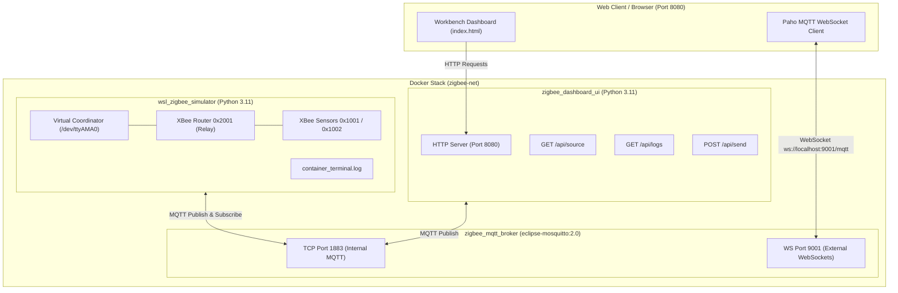
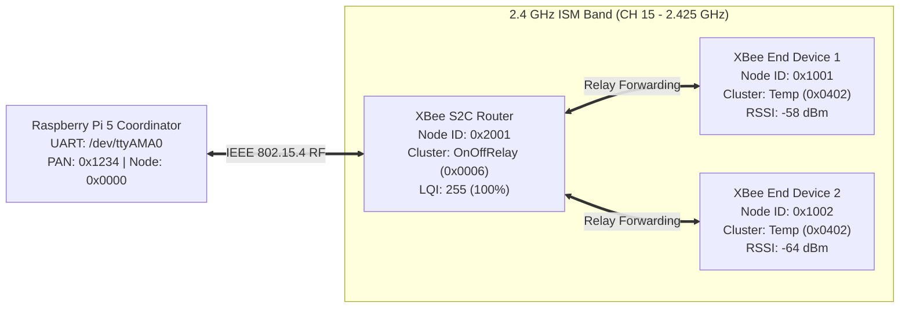

# Raspberry Pi 5 & XBee 802.15.4 Mesh Simulator Workbench
### Architecture, Deployment & Developer Reference Manual

---

## 1. Executive Overview

The **Raspberry Pi 5 & XBee Mesh Simulator Workbench** is a containerized, event-driven IoT simulation suite designed to replicate an IEEE 802.15.4 / Zigbee mesh network on a virtualized Linux/WSL environment.

It simulates a physical **Raspberry Pi 5 Hub** connected via UART (`/dev/ttyAMA0`) to an XBee Zigbee Coordinator (`PAN 0x1234`), communicating bi-directionally with an XBee Router (`0x2001`) and multiple Sensor End Devices (`0x1001`, `0x1002`).



---

## 2. Containerized Architecture & Stack Specifications

The simulation is partitioned into three decoupled Docker containers communicating over an isolated bridge network (`zigbee-net`):

| Container Name | Base Image | Ports | Purpose |
| :--- | :--- | :--- | :--- |
| `zigbee_mqtt_broker` | `eclipse-mosquitto:2.0` | `1883:1883`<br>`9001:9001` | Core message bus bridging internal TCP telemetry and external browser WebSockets. |
| `wsl_zigbee_simulator` | `python:3.11-slim` | None (internal) | Asynchronous simulation engine generating IEEE 802.15.4 RF frames and handling downlinks. |
| `zigbee_dashboard_ui` | `python:3.11-slim` | `8080:8080` | Zero-cache static web server and REST gateway for source code and terminal extraction. |

---

## 3. Emulated Hardware Nodes & Topology



### Node Specifications

1. **Raspberry Pi 5 Hub (`0x0000`)**:
   - **Role**: Zigbee Coordinator & Gateway.
   - **Serial Link**: Emulated UART bridge on `/tmp/zigbee_coord_pipe` (`115200` baud).
   - **PAN Configuration**: PAN ID `0x1234`, Channel `15 (2.425 GHz)`.
   - **Downlink Capabilities**: Intercepts `zigbee/custom/tx` and broadcasts or unicasts commands down the mesh.

2. **XBee S2C Mesh Router (`0x2001`)**:
   - **Role**: Full-function routing node and relay actuator.
   - **ZCL Cluster**: `0x0006 (OnOff)` relay.
   - **Behavior**: Emits periodic heartbeat packets every ~3.5s, toggling relay state (`ON`/`OFF`), and forwards downstream packets.

3. **XBee Sensor End Devices (`0x1001` & `0x1002`)**:
   - **Role**: Low-power telemetry nodes.
   - **ZCL Cluster**: `0x0402 (TemperatureMeasurement)`, Attribute `measured_value`.
   - **Behavior**: Emits random Gaussian temperature oscillations ($21.0^\circ\text{C} - 23.5^\circ\text{C}$) with simulated battery status ($95\% - 98\%$).

---

## 4. MQTT & WebSocket Topic Taxonomy

Communication between the Python engine, Mosquitto broker, and browser client follows a standardized topic hierarchy:

```
zigbee/
├── sensor/
│   ├── 1001                  # Telemetry frames from End Device 0x1001
│   └── 1002                  # Telemetry frames from End Device 0x1002
├── router/
│   └── 2001                  # Heartbeat & relay state from Router 0x2001
├── terminal/
│   ├── coordinator           # Stdout logs generated by Coordinator Hub
│   ├── router                # Stdout logs generated by Router 0x2001
│   ├── sensor                # Stdout logs generated by Sensors
│   └── all                   # Global multiplexed stdout stream
└── custom/
    ├── tx                    # Downlink commands sent from Dashboard to RPi
    └── rx                    # Uplink acknowledgment responses from nodes
```

### Telemetry Payload Formats

#### 1. Sensor Reading (`zigbee/sensor/<node_id>`)
```json
{
  "src_ieee": "00:15:8d:00:02:1001:ef:44",
  "endpoint": 1,
  "cluster": "TemperatureMeasurement",
  "attribute": "measured_value",
  "value": 22.42
}
```

#### 2. Router Heartbeat (`zigbee/router/2001`)
```json
{
  "src_ieee": "00:15:8d:00:02:2001:ef:44",
  "cluster": "OnOffRelay",
  "relay_state": true
}
```

#### 3. Custom Downlink Command (`zigbee/custom/tx`)
```json
{
  "target": "0x1001",
  "message": "PING_MESH",
  "timestamp": "2026-11-16T01:40:00.000Z"
}
```

#### 4. Node Acknowledgment (`zigbee/custom/rx`)
```json
{
  "src_node": "0x1001",
  "type": "EndDevice",
  "target": "0x1001",
  "original_msg": "PING_MESH",
  "time": "01:40:00",
  "lqi": 248,
  "rssi": "-56dBm",
  "reply": "Sensor 0x1001 processed: 'PING_MESH' (battery=98%)"
}
```

---

## 5. Web Server REST API Specification

The `dashboard-ui` microservice ([src/web_server.py](file:////wsl.localhost/Ubuntu/home/parth/zigbee_wsl_sim/src/web_server.py)) exposes dedicated endpoints to support dynamic inspection:

### `GET /api/source`
Fetches exact live Python source code directly from container storage.
- **Parameters**: `target` (`coordinator` | `sensor` | `router` | `full`)
- **Response**:
```json
{
  "target": "sensor",
  "filename": "simulation_daemon.py",
  "path": "/app/src/simulation_daemon.py",
  "code": "class VirtualZigbeeNode: ...",
  "full_code": "#!/usr/bin/env python3 ..."
}
```

### `GET /api/logs`
Extracts real timestamped container output from [src/container_terminal.log](file:////wsl.localhost/Ubuntu/home/parth/zigbee_wsl_sim/src/container_terminal.log).
- **Parameters**: `target` (`coordinator` | `sensor` | `router` | `all`), `tail` (integer, default `50`)
- **Response**:
```json
{
  "target": "coordinator",
  "container": "wsl_zigbee_simulator",
  "logs": [
    "[01:40:00] [COORDINATOR] PAN 0x1234 active. Listening on /tmp/zigbee_coord_pipe...",
    "[01:40:05] [COORDINATOR TX Frame] Target: 0x1001 | Payload: 'PING_MESH'"
  ]
}
```

### `POST /api/send`
HTTP fallback gateway to inject custom downlink frames into the MQTT broker.
- **Payload**: `{"target": "0xFFFF", "message": "ALERT_BUZZER:ON"}`
- **Response**: `{"status": "success", "sent": {...}}`

---

## 6. Workbench User Interface Layout & Controls

The UI ([src/static/index.html](file:////wsl.localhost/Ubuntu/home/parth/zigbee_wsl_sim/src/static/index.html)) provides a high-density, low-latency operator console:

```
+-------------------------------------------------------------------------------+
| PI5-XBEE-WORKBENCH // 802.15.4 KERNEL SIMULATION        [ws://localhost:9001] |
+------------------------------------+------------------------------------------+
| HARDWARE INVENTORY                 | LIVE UART & RF FRAME BUFFER              |
|                                    |                                          |
| [COORD]  Raspberry Pi 5 Hub   ->   | [01:40:01] zigbee/sensor/1001: {...}     |
| [ROUTER] XBee Router  [ON]    ->   | [01:40:02] zigbee/router/2001: {...}     |
| [SENSOR] XBee Sensor1 [22.4C] ->   | [01:40:04] zigbee/sensor/1002: {...}     |
| [SENSOR] XBee Sensor2 [21.8C] ->   |                                          |
|                                    |                                          |
| BUS DIAGNOSTICS                    |                                          |
| Processed Packets: 142             |                                          |
| Frequency: 2.425 GHz (CH 15)       |                                          |
+------------------------------------+------------------------------------------+
```

### Modal Inspection Console

Clicking any node card opens the **Node Inspection Modal**:
1. **`Component` / `Full File` Switch**: Inspect live Python handler code without leaving the browser.
2. **`Custom TX` Button**:
   - Opens the downlink command console.
   - Select targets: `Broadcast (0xFFFF)`, `Sensor 1 (0x1001)`, `Sensor 2 (0x1002)`, or `Router (0x2001)`.
   - Dispatch custom messages or one-click presets (`PING_MESH`, `POLL_TEMP_NOW`, `RELAY_TOGGLE`, `ALERT_BUZZER:ON`).
3. **Live Container Terminal**:
   - Tail of `docker logs -f wsl_zigbee_simulator` rendered in dark terminal syntax.
4. **Keybinding**: Press `Esc` anytime to dismiss the modal.

---

## 7. Operations & Maintenance Playbook

### ⚡ 1-Click Foolproof Launch (Fresh Workspace)

On any fresh clone or clean machine, run the automated launch script:
```bash
cd ~/zigbee_wsl_sim
./run.sh
```
This automated script handles all prerequisites:
1. Verifies that the Docker engine/daemon is running.
2. Creates the necessary directory structure (`mosquitto/data`, `mosquitto/log`, `mosquitto/config`).
3. Automatically fixes Linux/Docker permissions (`chmod 777`) so Mosquitto container UID `1883` never fails with write errors.
4. Builds and boots all 3 containers with `docker compose up -d --build`.
5. Performs a healthcheck and prints the direct browser URL (`http://localhost:8080/`).

---

### Manual Rebuild & Launch (Alternative)
```bash
cd ~/zigbee_wsl_sim

# 1. Ensure directory structure & permissions
mkdir -p mosquitto/data mosquitto/log mosquitto/config
chmod -R 777 mosquitto/data mosquitto/log

# 2. Restart container stack cleanly
docker compose down --remove-orphans
docker compose up -d --build
```

### Container Status Verification
```bash
docker ps --format "table {{.Names}}\t{{.Status}}\t{{.Ports}}"
```
Expected output:
```text
NAMES                  STATUS         PORTS
wsl_zigbee_simulator   Up 5 minutes   
zigbee_mqtt_broker     Up 5 minutes   0.0.0.0:1883->1883/tcp, 0.0.0.0:9001->9001/tcp
zigbee_dashboard_ui    Up 5 minutes   0.0.0.0:8080->8080/tcp
```

### Viewing Real-Time Broker & Simulator Logs
```bash
# Mosquitto broker log stream
docker logs -f zigbee_mqtt_broker

# Simulator engine stdout log stream
docker logs -f wsl_zigbee_simulator
```

### Direct WebSocket Diagnostic Check
You can test the Mosquitto WebSocket listener on port 9001 from Python:
```python
import socket
s = socket.socket()
s.connect(('localhost', 9001))
s.sendall(b"GET /mqtt HTTP/1.1\r\nHost: localhost:9001\r\nUpgrade: websocket\r\nConnection: Upgrade\r\nSec-WebSocket-Key: dGhlIHNhbXBsZSBub25jZQ==\r\nSec-WebSocket-Version: 13\r\nSec-WebSocket-Protocol: mqtt\r\n\r\n")
print(s.recv(1024).decode())
s.close()
```
*(Should return `HTTP/1.1 101 Switching Protocols`)*.
